  

  **Capture &nbsp;·&nbsp; Analyze &nbsp;·&nbsp; Exploit &nbsp;·&nbsp; Document**

  <a href="#write-ups">Write-ups</a> &nbsp;·&nbsp; <a href="#team">Team</a> &nbsp;·&nbsp; <a href="#about">About</a>

  
  
  

  

## About

Write-ups, technical breakdowns, and exploit scripts from the CTF events our team has competed in. This repository is our working archive: what we solved, and how.

## Write-ups

| Event | Year | Category | Write-up |
| :--- | :---: | :--- | :--- |
| Play It Plus | 2026 | Mixed | [PDF](./Writeup%20Play%20It%20Pluss_compressed.pdf) |
| IONIC Quals | 2026 | Mixed | [PDF](./Z3RODAY_SOLVE24_QualsIONIC2...) |

## Team

| Handle | Name |
| :--- | :--- |
| Vanishzh | Ruco Poetra Widjaya |
| Sempor | Itoankub |
| Misarah | Widuamaziana |

 

  © 2026 ZeroDay, SMKN 1 Boyolangu

